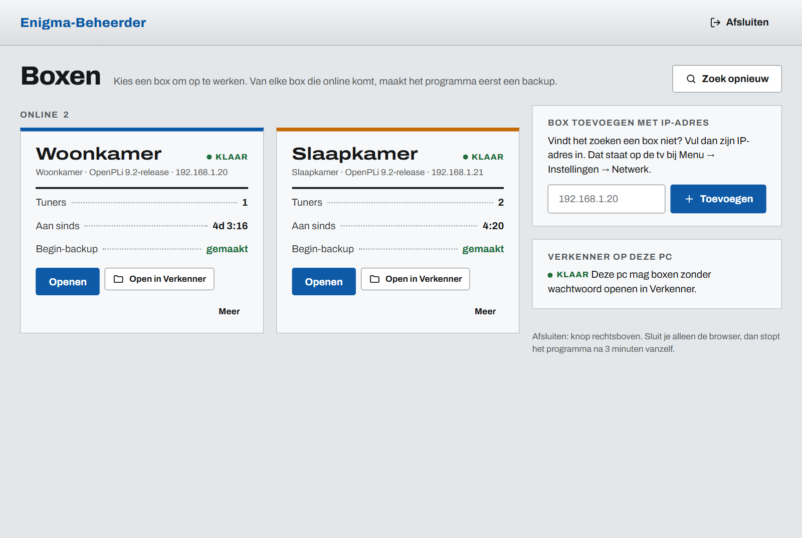
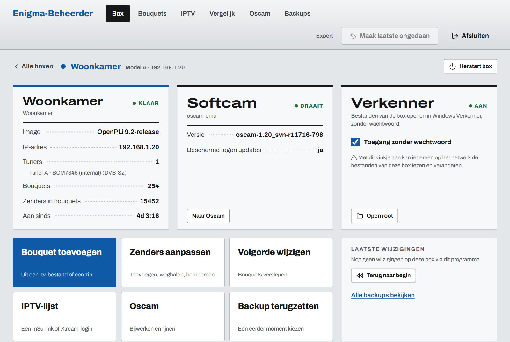
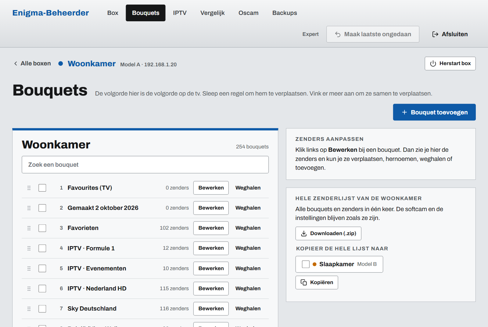
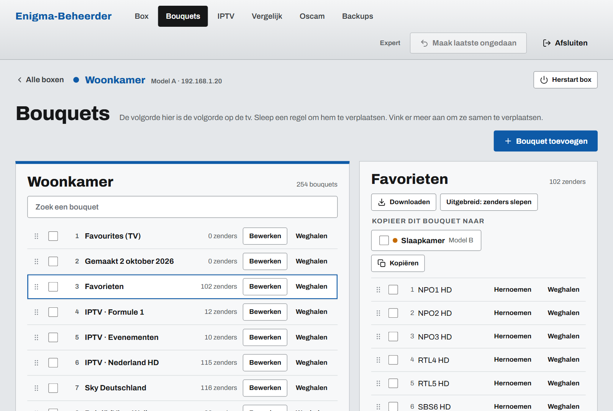
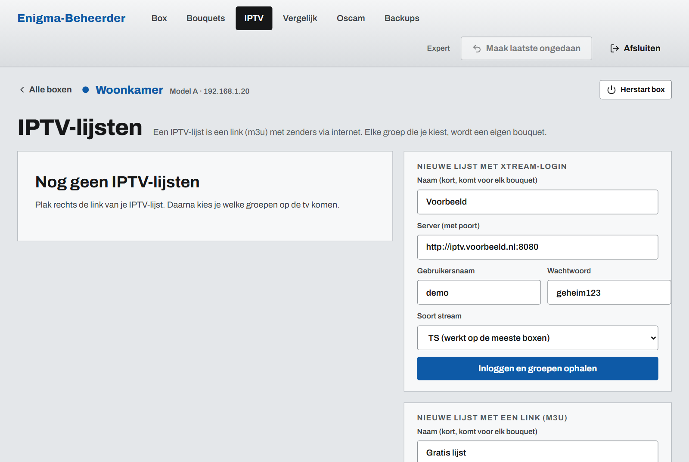
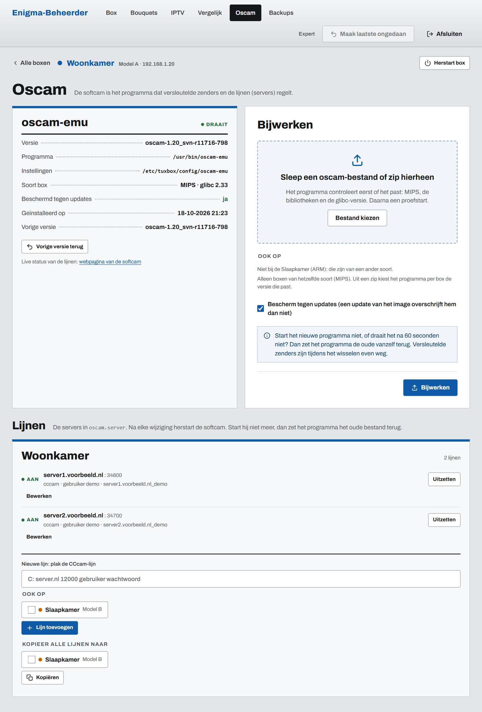
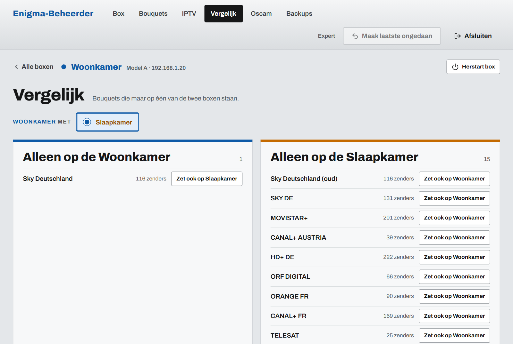
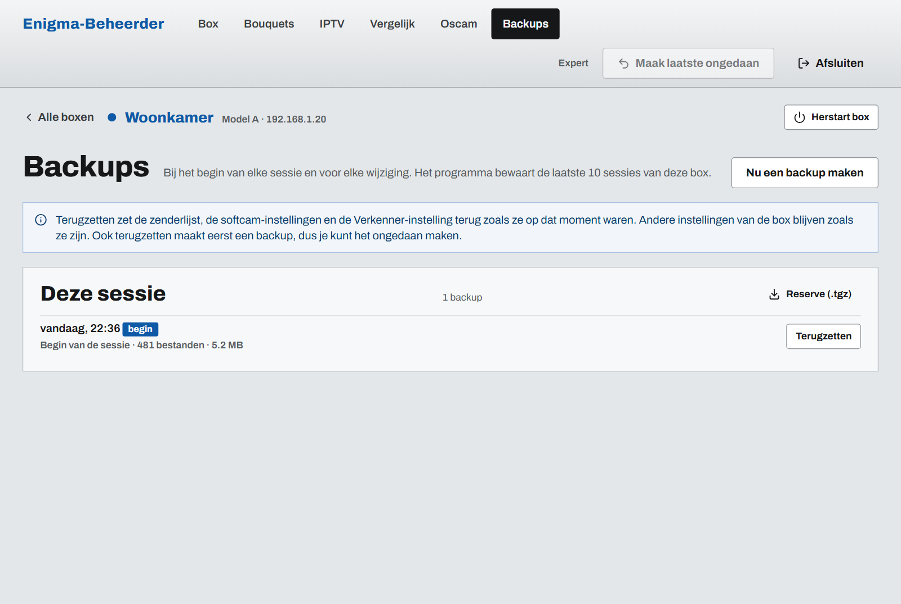

# Enigma-Beheerder

Beheer de zenderlijsten, IPTV, oscam en backups van je satellietontvanger
(Enigma2: OpenPLi, OpenATV en andere). Vanaf een gewone Windows-pc.

## Downloaden

[**Download Enigma-Beheerder.exe**](https://github.com/materharmsel/enigma-beheerder/releases/latest/download/Enigma-Beheerder.exe)

Het is één bestand. Je hoeft niets te installeren.
Zet het in een eigen map, bijvoorbeeld op een USB-stick.

## Zo ziet het eruit

De namen en adressen op deze plaatjes zijn voorbeelden.

### Alle boxen op het netwerk
Het programma vindt de boxen zelf. Van elke box maakt het eerst een backup.

### Eén box
Wat er op de box staat, of de softcam draait, en of je de box in Windows Verkenner kunt openen.

### Bouquets
De volgorde hier is de volgorde op de tv. Sleep een bouquet naar een andere plek.
Je kunt de hele lijst ook naar een andere box kopiëren.

### Zenders aanpassen
Klik op **Bewerken** bij een bouquet. Dan kun je zenders verplaatsen, hernoemen of weghalen.

### IPTV
Plak een m3u-link of vul een Xtream-login in. Elke groep die je kiest, wordt een eigen bouquet.

### Oscam
Werk de softcam bij met een bestand of zip. Past hij niet of start hij niet, dan zet het programma de oude terug.
Onderaan zet je lijnen (servers) aan of uit, of kopieer je ze naar een andere box.

### Vergelijk
Zie welke bouquets maar op één van twee boxen staan. Met één klik zet je ze ook op de andere.

### Backups
Kies een eerder moment en zet het terug. Ook terugzetten maakt eerst een backup.

## Starten

Dubbelklik op `Enigma-Beheerder.exe`.
De browser gaat vanzelf open. Het programma zoekt dan de boxen op het netwerk.

De eerste keer laat Windows misschien een blauw scherm zien:
"Windows heeft uw pc beschermd".
Klik dan op **Meer info** en daarna op **Toch uitvoeren**.
Dat komt doordat het programma geen betaalde handtekening heeft.

Geeft je virusscanner een melding? Dat is vals alarm. Het gebeurt vaker bij
programma's die met Python gemaakt zijn. Zet het programma dan op de lijst
met uitzonderingen.

## Afsluiten

Klik rechtsboven op **Afsluiten**.
Sluit je alleen de browser, dan stopt het programma na 3 minuten vanzelf.
De boxen werken gewoon door.

## De map gegevens

Naast het programma komt een map `gegevens`. Daarin staan:

- de backups van je boxen,
- de lijst met boxen (en wachtwoorden, als je "Onthoud" aanvinkt),
- je IPTV-lijsten,
- werkende oscam-versies.

Neem de hele map mee als je het programma kopieert. Gooi hem niet weg:
dan zijn je backups ook weg.

## Backups

Het programma maakt een backup van elke box zodra die online komt.
Voor elke wijziging komt er ook een backup.

- Met **Maak laatste ongedaan** draai je de laatste wijziging terug.
- Met **Terug naar begin** zet je de box terug zoals hij was toen je
  het programma opende.

De laatste 10 keer dat je het programma gebruikte, blijven bewaard.

Bij Backups staat ook een "Reserve (.tgz)". Dat is een gewoon archief.
Je kunt het openen met 7-Zip.
